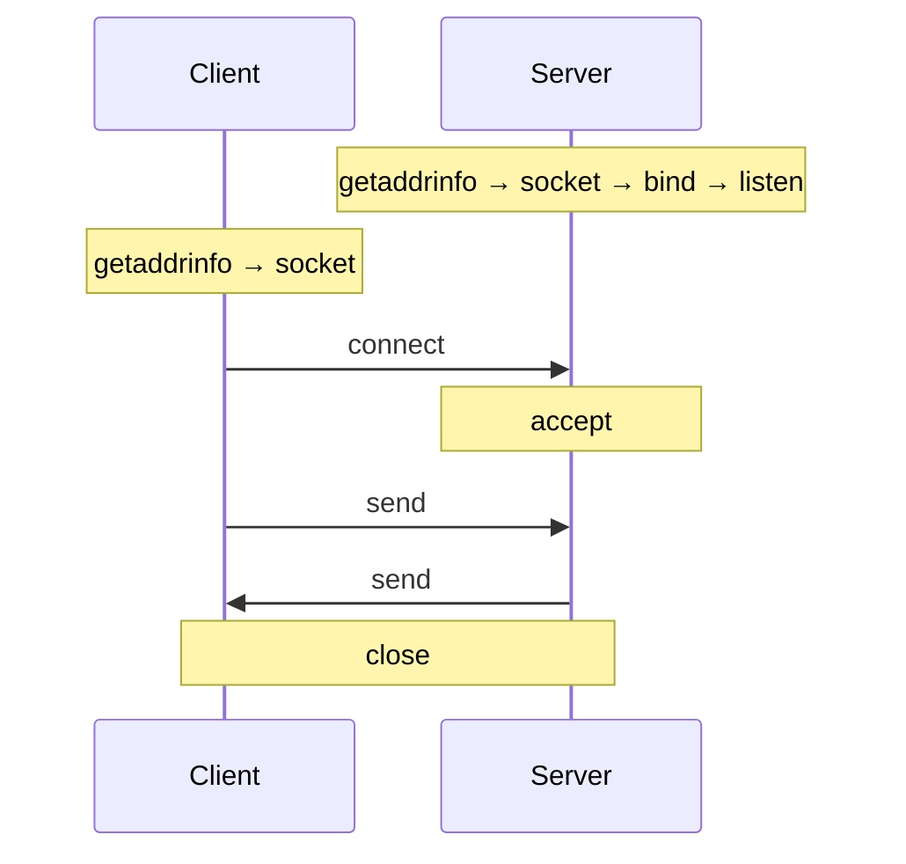

# C Learning & Projects

[](https://github.com/Isamd4/C/actions/workflows/build.yml)


[](LICENSE)

A collection of C programs I wrote while learning the language: linked lists
built from scratch, a file-backed attendance system, and a step-by-step tour of
socket programming that ends with a client/server talking to MySQL. They are
learning exercises, not production code, so feel free to read, copy, and adapt
them.

## Contents

| Folder | Topic | Concepts |
| --- | --- | --- |
| [`data_structures/`](data_structures/) | Linked lists | `malloc`/`free`, pointers, singly and doubly linked lists |
| [`lecturer_attendance_system/`](lecturer_attendance_system/) | Console attendance tracker | structs, menus, file I/O, CSV parsing with `strtok` |
| [`network_programming/`](network_programming/) | Socket programming | `getaddrinfo`, TCP and UDP clients/servers, IPv6 dual stack, MySQL C API |

```
.
├── data_structures/
│   ├── singly_linked_list/     # append, prepend, insert, delete, reverse
│   └── doubly_linked_list/     # same operations with prev pointers
├── lecturer_attendance_system/ # add/view/edit/delete students, mark attendance
└── network_programming/
    ├── basics/                 # getaddrinfo → socket → bind → listen → accept
    ├── tcp/                    # TCP clients and servers, tiny HTTP server
    ├── udp/                    # UDP with and without connect()
    ├── exercise_reverse_string/
    ├── maintaining_connection/ # servers that keep serving in a loop
    ├── pre_chat_server/        # find out who the client is (getnameinfo)
    ├── student_records_sql/    # TCP client/server backed by MySQL
    └── concurrent_server/      # start of a multi-client server (C++)
```

## Highlights

Every networking program follows the same socket lifecycle, built up one call
at a time in [`network_programming/basics/`](network_programming/basics/):



## Getting started

**Requirements:** a C compiler (`gcc` or `clang`), `make`, and Linux, macOS, or
WSL (the networking code uses POSIX sockets).

```bash
git clone https://github.com/Isamd4/C.git
cd C/network_programming/udp
make                       # build every program in this folder
./udpserver &              # terminal 1: wait for a datagram
./udpclientnoconnect       # terminal 2: send one and print the reply
make clean                 # remove build outputs
```

Each folder has its own README with details.

## Compatibility

The code is kept as it was originally written (2022–2023), so a few programs
depend on older C behaviour. The makefiles take care of this:

| Program | Needs | Why |
| --- | --- | --- |
| `doubly_linked_list`, `lecturer_attendance_system` | `-Wno-error=implicit-function-declaration -Wno-error=implicit-int` | They call functions before declaring them. GCC 14+ and Clang 16+ treat that as an error by default. |
| `lecturer_attendance_system` | `-std=gnu99` | It uses `gets()`, which was removed in C11; glibc only declares it for older standards. |
| `student_records_sql/` | `libmysqlclient` (`mysql_config` on the `PATH`) and a MySQL server | See its [README](network_programming/student_records_sql/). |
| `concurrent_server/` | a C++ compiler | Written in C++. |

Everything builds on GCC 11.4 (Ubuntu 22.04 / WSL2) and in CI on
`ubuntu-latest`. Expect compiler warnings: they are left in on purpose.

## Contributing

Spotted a bug or have a cleaner solution? Issues and pull requests are welcome.

## License

Released under the [MIT License](LICENSE).
