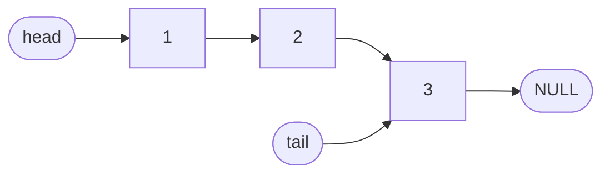

# Data Structures

Linked lists of `int`s implemented from scratch with `malloc` and `free`. Each
program keeps global `head` and `tail` pointers and runs a small demo on the
numbers `1..n`, where `n` is read from standard input.

| Folder | Operations |
| --- | --- |
| [`singly_linked_list/`](singly_linked_list/) | `append`, `prepend`, `insert` at a position, `deleteFirst`, `deleteLast`, `deleteAtPos`, `reverseList`, `countList`, `print` |
| [`doubly_linked_list/`](doubly_linked_list/) | `append`, `prepend`, `insert` at a position, `deletFirst`, `deleteLast`, `deleteAtPos`, `countList`, `print` (with a `prev` pointer on every node) |



## Build & run

```bash
cd singly_linked_list
make
echo 5 | ./singly_linked_list
```

## Known issues

- `doubly_linked_list`: `insert` at a middle position does not link the new
  node into the list yet (noted in the source), and the delete functions do
  not update every `prev`/`tail` pointer.

Both programs were first written in Code::Blocks on Windows; they build with
any C compiler. See [Compatibility](../README.md#compatibility) for the
compiler flags the doubly linked list needs.
