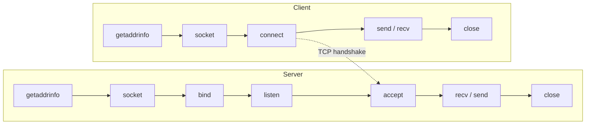

# Network Programming

Socket programming in C with the POSIX API, built up one system call at a
time: from resolving an address, to TCP and UDP clients and servers, to a
client/server that answers queries from a MySQL database.

Servers listen on `localhost`; start the server in one terminal and its client
in another.

| Folder | Topic | Port |
| --- | --- | --- |
| [`basics/`](#basics) | The server-side calls one by one | 8080, 8085 |
| [`tcp/`](#tcp) | TCP clients and servers, a tiny HTTP server, IPv6 dual stack | 8082 |
| [`udp/`](#udp) | UDP with `sendto`/`recvfrom` and with `connect` | 8082 |
| [`exercise_reverse_string/`](#exercise_reverse_string) | UDP server that reverses the client's text | 8082 |
| [`maintaining_connection/`](#maintaining_connection) | Servers that keep serving in a loop | 8082 |
| [`pre_chat_server/`](#pre_chat_server) | Server replies with the client's address (`getnameinfo`) | 8082 |
| [`student_records_sql/`](#student_records_sql) | TCP client/server backed by MySQL | 8083 |
| [`concurrent_server/`](#concurrent_server) | Start of a multi-client server (C++) | 8083 |

## Socket lifecycle



UDP skips `listen`, `accept`, and `connect`: the server `bind`s and calls
`recvfrom`, the client calls `sendto` directly.

## basics

| File | What it adds |
| --- | --- |
| `getaddrinfo.c` | Resolve `yahoo.com:80` with `getaddrinfo` |
| `newsock.c` | Create a socket from the result |
| `tcpserverbind.c` | `bind` it to port 8080 |
| `tcplisten.c` | `listen` on port 8085 |
| `tcpaccept.c` | `accept` one client on port 8085 (try `nc localhost 8085`) |

## tcp

| File | Description |
| --- | --- |
| `tcpclient.c` | Connect to `pool.ntp.org` port 123 and print what comes back |
| `tcpserverreceive.c` | Accept a client and print what it sends |
| `tcpserversend.c` | Answer with an HTML page over IPv6: open http://[::1]:8082 |
| `dualstacktcpserver.c` | Same, but accepts IPv4 and IPv6 (`IPV6_V6ONLY` off): open http://localhost:8082 |
| `exercisetcpserver.c` / `exercisetcpclient.c` | Server echoes the client's message back with a greeting |

## udp

| File | Description |
| --- | --- |
| `udpserver.c` | Receive one datagram and reply |
| `udpclientnoconnect.c` | Client using `sendto` / `recvfrom` |
| `udpclientconnect.c` | Client that calls `connect` first, then `send` / `recv` |

## exercise_reverse_string

`udpclient` reads a line from standard input, `udpserver` sends it back
reversed.

## maintaining_connection

| File | Description |
| --- | --- |
| `tcpservermaintain.c` / `tcpclientmaintain.c` | TCP server that keeps accepting clients and echoes each message with a `server<<` prefix |
| `udpservermaintain.c` / `udpclientmaintain.c` | UDP chat loop: the client sends lines from standard input, the server echoes them with the client's IP |

## pre_chat_server

| File | Description |
| --- | --- |
| `tcpservergetclientname.c` / `tcpclientgetname.c` | TCP server that replies with the client's IP address |
| `udpservergetnameofclient.c` | The same over UDP (try `echo hi \| nc -u localhost 8082`) |

## student_records_sql

`serverconnectedtosql` accepts TCP connections on port 8083 and answers
requests from a MySQL table. A request is `<operation>@<argument>`:

| Operation | Request | Server |
| --- | --- | --- |
| 1 | `1@...` | Return all students, separated by `\|` |
| 2 | `2@<reg_no>` | Return one student |
| 3, 4, 5 | add, update, delete | Not implemented yet (stubs) |

`myclient` currently sends operation 2: type a registration number and it
prints the server's answer.

The server connects to MySQL on `localhost` as `root` with an empty password
and uses the database `c`. From the queries and the client, the table looks
like this (column names other than `reg_no` are a guess):

```sql
CREATE DATABASE c;
CREATE TABLE c.students (
  reg_no     VARCHAR(10) PRIMARY KEY,
  first_name VARCHAR(50),
  last_name  VARCHAR(50),
  department VARCHAR(50),
  cgpa       DECIMAL(3, 2)
);
```

Building needs the MySQL client library and `mysql_config`:

```bash
sudo apt install default-libmysqlclient-dev   # Debian / Ubuntu
make
```

## concurrent_server

`Practice.cpp` and `PracticeClient.cpp` (C++) are the start of a server that
accepts clients in a loop, the first step towards serving several clients
at once. They only connect so far; nothing is sent.

## Build & run

```bash
cd udp
make
./udpserver            # terminal 1
./udpclientnoconnect   # terminal 2
```

Every folder has a makefile; `make clean` removes the binaries. The code uses
POSIX sockets, so it runs on Linux, macOS, and WSL, but not natively on
Windows.
