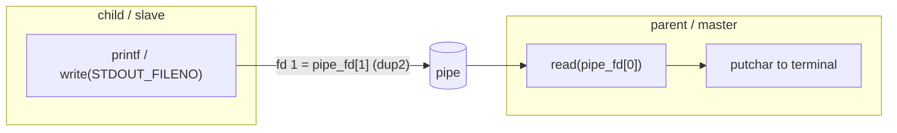

# Processes & Threads

Playing with processes on Linux using the POSIX API: creating a child with
`fork`, connecting parent and child with a `pipe`, and redirecting the child's
standard output with `dup2`.

| Folder | Topic | Concepts |
| --- | --- | --- |
| [`process/`](process/) | Parent reads what the child prints | `fork`, `getpid`, `pipe`, `dup2`, `STDOUT_FILENO`, `read`/`write`, `waitpid` |



## Build & run

The project uses CMake:

```bash
cd process
cmake -S . -B build
cmake --build build
./build/main
```

See the [`process/` README](process/) for what the program does.
