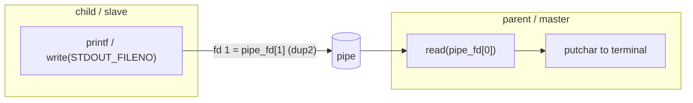

# Processes & Threads

Playing with processes on Linux using the POSIX API: creating a child with
`fork`, connecting parent and child with a `pipe`, redirecting the child's
standard output with `dup2`, and running a command in the child with `execlp`
while the parent reads its progress without blocking.

| Folder | Topic | Concepts |
| --- | --- | --- |
| [`process/`](process/) | Parent reads what the child prints | `fork`, `getpid`, `pipe`, `dup2`, `STDOUT_FILENO`, `read`/`write`, `waitpid` |
| [`process_com_without_wait/`](process_com_without_wait/) | Parent reads a command's progress without blocking | `execlp`, `fcntl`, `O_NONBLOCK`, `waitpid` with `WNOHANG` |



## Build & run

Both projects use CMake:

```bash
cd process                       # or process_com_without_wait
cmake -S . -B build
cmake --build build
./build/main                     # ./build/PROCESS_COM_NO_WAIT in process_com_without_wait
```

See each project's README for what the program does.
