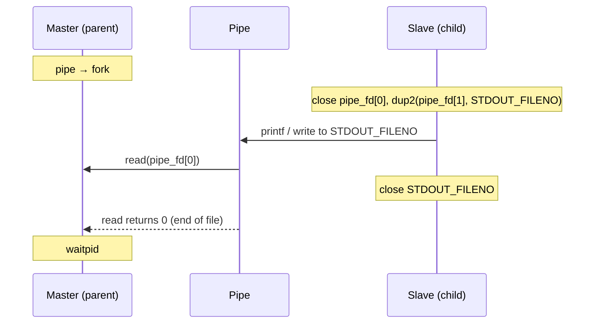

# Process

The parent process (the master) reads everything its child process (the slave)
writes to standard output.

A process can't `read` back from its own `STDOUT_FILENO`, because it is a
write-only file descriptor that goes straight to the terminal. So the program
creates a `pipe` before `fork`, and in the child uses `dup2` to point
`STDOUT_FILENO` at the write end of the pipe. Anything the child prints with
`printf` or `write` now goes into the pipe, and the parent reads it from the
read end and prints it on the real terminal.

| Step | Master (parent) | Slave (child) |
| --- | --- | --- |
| 1 | Prints its pid, `pipe`, `fork` | |
| 2 | Closes the write end `pipe_fd[1]` | Closes the read end `pipe_fd[0]` |
| 3 | | `dup2(pipe_fd[1], STDOUT_FILENO)`, then closes `pipe_fd[1]` |
| 4 | `read`s the pipe one byte at a time and `putchar`s it | `printf`s one progress line per second for each character of its message |
| 5 | | `write`s "Child <pid>, is done sending" and closes `STDOUT_FILENO` |
| 6 | `read` returns 0 (end of file), `waitpid` for the child | Exits |



## Build & run

```bash
cmake -S . -B build
cmake --build build
./build/main
```

The child sleeps one second per character of its message, so the program
takes about 25 seconds to finish. Expected output (the pids will differ):

```
Hi, I am the master 140446
I want to read from the slave 140446
Child 140447, is done sending
Finished Receiving by Master 140446
```

Written and tested on Linux (WSL2). It uses `<sys/errno.h>`, which exists on
Linux and macOS; `<errno.h>` is the portable header.
