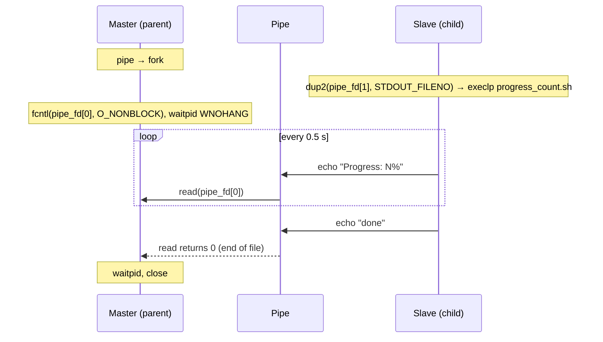

# Process Communication Without Wait

The parent process (the master) runs a command in its child process (the
slave) and reads the command's progress as it comes, without blocking on
`read` or `waitpid`.

The command is [`progress_count.sh`](progress_count.sh), a small script that
simulates a long-running job: it prints `Progress: 0%` up to `Progress: 100%`
every half second, then `done`.

The slave points its `STDOUT_FILENO` at the pipe with `dup2` and replaces
itself with the script using `execlp`. The script keeps the slave's file
descriptors, so everything it `echo`es goes into the pipe. The master makes
the read end of the pipe non-blocking with `fcntl` and `O_NONBLOCK`, so `read`
returns straight away when there is nothing to read, and calls `waitpid` with
`WNOHANG` on every pass of its loop, so it does not hang waiting for the slave.
Between passes it sleeps 90 ms with `usleep`, and that is where it could do
other work.

| Step | Master (parent) | Slave (child) |
| --- | --- | --- |
| 1 | `pipe`, prints a greeting, `fork` | |
| 2 | Closes the write end `pipe_fd[1]` | Closes the read end `pipe_fd[0]` |
| 3 | Sets `O_NONBLOCK` on `pipe_fd[0]` with `fcntl` | `dup2(pipe_fd[1], STDOUT_FILENO)`, then closes `pipe_fd[1]` |
| 4 | Loop: `waitpid(child_pid, NULL, WNOHANG)`, `read`, print "Got ...", `usleep(90000)` | `execlp` the script |
| 5 | `read` returns `-1` with `EAGAIN` while there is no data yet: keep looping | The script echoes its progress into the pipe |
| 6 | `read` returns 0 (end of file): leave the loop, `waitpid(child_pid, NULL, 0)`, close the pipe | The script exits |



## Why `fcntl` and not `pipe2`

`pipe2(pipe_fd, O_NONBLOCK)` also makes the pipe non-blocking, but on both
ends. If the master is busy and the pipe buffer fills up, the script's `write`
would then fail with `EAGAIN` instead of waiting. With `fcntl` only the
master's read end is non-blocking.

## Build & run

```bash
cmake -S . -B build
cmake --build build
./build/PROCESS_COM_NO_WAIT
```

Run it from this folder: `main.c` starts the script as `./progress_count.sh`,
which is relative to the folder you run the program from, not to the binary.
The script must be executable (`chmod +x progress_count.sh`).

Output:

```
Hi i am master, and i am creating a slave später
Got Progress: 0%

Got Progress: 20%

...
Got Progress: 100%

Got done
```

It finishes after about 3 seconds, once the script is done.
